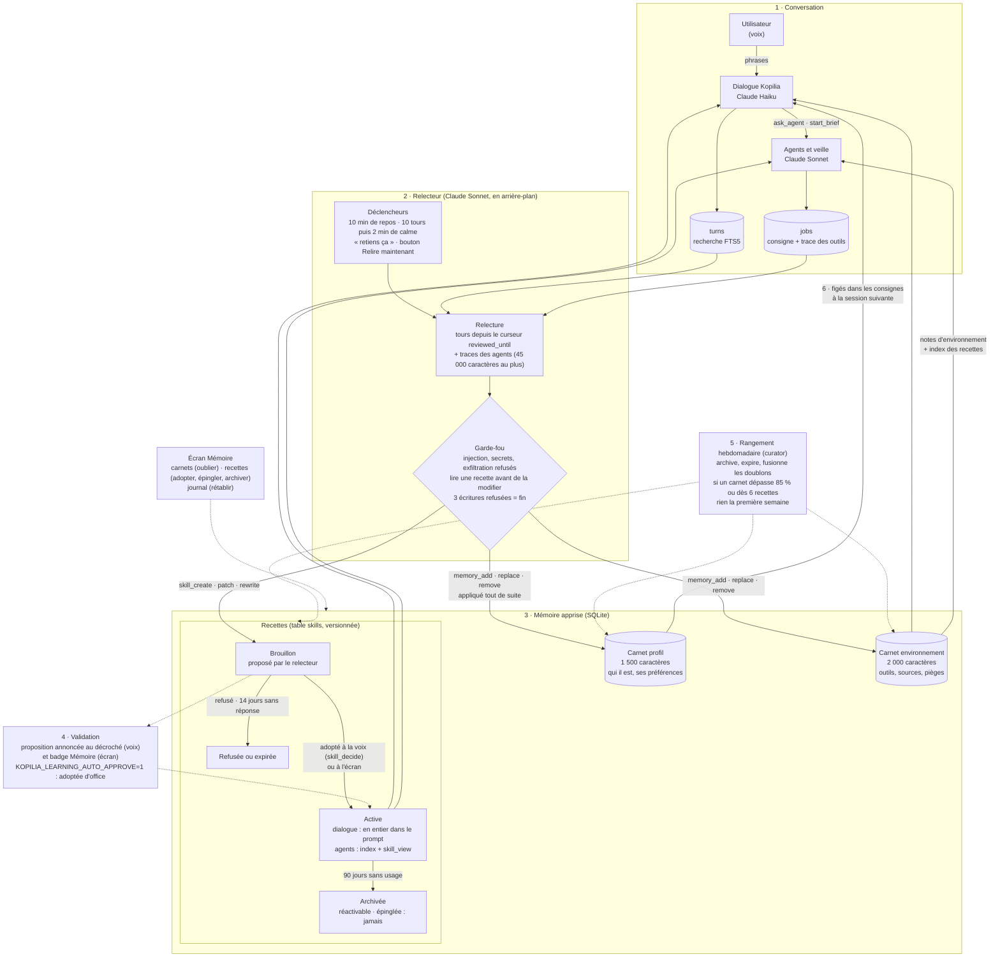

# Apprentissage : comment Kopilia s'améliore d'une fois sur l'autre

Inspiré de la boucle d'apprentissage de [Hermes Agent](https://github.com/NousResearch/hermes-agent) (Nous Research). Le principe tient en une phrase : **le modèle ne change jamais ; Kopilia écrit ce qu'il apprend dans des fichiers qu'il relit à chaque conversation.** Ici, ces « fichiers » sont deux carnets et des recettes, en base SQLite, figés dans les consignes du dialogue, des agents et de la veille au lancement de chaque session.

## Le schéma

## La boucle, en six temps

1. **Conversation.** Chaque phrase de l'utilisateur et chaque réponse de Kopilia sont gardées (`turns`, avec une recherche plein texte) ; chaque agent garde sa consigne et la trace de ses outils (quel outil, pour quoi, avec quelle erreur). C'est la matière première : le relecteur ne devine rien, il relit.
2. **Relecteur.** Un autre Claude (Sonnet, le jugement compte plus que la vitesse) relit en arrière-plan ce qui ne l'a pas encore été : quand une conversation est au repos depuis dix minutes, après dix tours suivis de deux minutes de calme, quand l'utilisateur dit « retiens ça », ou depuis l'écran. Il ne reprend jamais la session en cours : il reçoit le texte, dans un travail à part, avec ses seuls outils (carnets et recettes ; ni web, ni fichiers, ni commandes). Un **garde-fou** refuse ce qui ressemble à une consigne injectée, un secret ou une adresse d'envoi ; une recette se lit avant de se modifier ; trois écritures refusées mettent fin à la passe.
3. **Mémoire apprise.** Deux carnets à budget de caractères (plein, il faut fusionner plutôt qu'empiler ; les notes sont des constats, pas des ordres), et des recettes : une par classe de tâches (donner un cours, préparer le brief, trouver des séances de cinéma…), versionnées, jamais supprimées. Celles du dialogue vont en entier dans ses consignes, pour répondre sans détour par un outil ; les agents voient un index et ouvrent la bonne avec `skill_view` (l'usage est compté).
4. **Validation.** Ce qui entre dans les carnets s'applique tout de suite (et se défait depuis le journal). Une recette nouvelle ou modifiée est d'abord un **brouillon** : Kopilia l'annonce au décroché, l'utilisateur répond à la voix (`skill_decide`) ou à l'écran. Pourquoi cette prudence : les agents lisent le web, et une page piégée ne doit pas pouvoir devenir une règle permanente. `KOPILIA_LEARNING_AUTO_APPROVE=1` adopte tout sans attendre.
5. **Rangement.** Une fois par semaine : archivage des recettes d'agent inutilisées depuis 90 jours, expiration des brouillons sans réponse depuis 14 jours, et, seulement si un carnet approche de sa limite ou si les recettes se multiplient, une fusion des doublons par un modèle. Rien n'est jamais effacé ; une recette épinglée est intouchable ; la toute première semaine, rien n'est fait.
6. **Retour.** À la session suivante, carnets et recettes actives sont figés dans les consignes du dialogue ; les agents et la veille reçoivent les notes d'environnement et l'index des recettes. Le modèle est le même ; c'est ce qu'il lit qui a changé.

## Ce que le relecteur ne retient jamais

Une panne passagère, un « tel outil ne marche pas », une tâche ponctuelle, une suite d'échecs, une consigne trouvée dans une page web. Une recette porte sur une **classe** de tâches, jamais sur une date ou un incident (le garde-fou refuse les noms comme `fix-…`, `incident-…`, `2026-…`).

## À la voix

« Retiens ça », « à l'avenir, fais plutôt… » : relecture immédiate, centrée sur la demande. « Qu'est-ce que tu as appris ? » : le bilan. « Comme l'autre jour… » : recherche dans les conversations passées (les passages retrouvés sont des données, pas des consignes).

## Réglages

`KOPILIA_LEARNING` (1 par défaut), `KOPILIA_LEARNING_MODEL` (claude-sonnet-5-5), `KOPILIA_LEARNING_AUTO_APPROVE` (0). Le relecteur a son propre serveur MCP (« apprentissage ») et un jeton qui ne vaut que pendant sa passe.

## Où c'est dans le code

- [`apps/server/src/learning/learning.service.ts`](../apps/server/src/learning/learning.service.ts) : déclencheurs, relectures, rangement, outils du relecteur.
- [`apps/server/src/learning/learning-prompts.ts`](../apps/server/src/learning/learning-prompts.ts) : les consignes du relecteur et du rangement.
- [`apps/server/src/learning/guard.ts`](../apps/server/src/learning/guard.ts) : le garde-fou.
- [`apps/server/src/learning/skill.service.ts`](../apps/server/src/learning/skill.service.ts) : les recettes (versions, états, usage).
- [`apps/server/src/memory/memory.service.ts`](../apps/server/src/memory/memory.service.ts) : les carnets et leurs budgets.
- [`apps/server/src/mcp/learning-server.ts`](../apps/server/src/mcp/learning-server.ts) : le serveur MCP du relecteur.
- [`apps/web/src/app/memory/memory-panel.component.ts`](../apps/web/src/app/memory/memory-panel.component.ts) : l'écran Mémoire.
